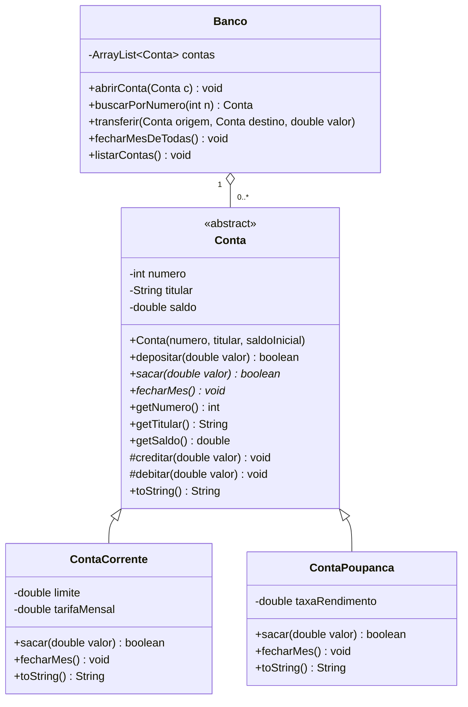

# Mini Banco no Terminal (Java)

Projeto de estudo em **Java puro** para praticar os três pilares da orientação a objetos: **encapsulamento**, **herança** e **polimorfismo**. Tudo roda no terminal com `Scanner` e `System.out`, sem interface gráfica e sem frameworks.

> Status: em andamento.

## Objetivo

Montar um banco simples com tipos diferentes de conta (corrente e poupança), onde cada tipo tem regras próprias de saque e de fechamento do mês, mas o `Banco` trata todas de forma única, via polimorfismo.

## Tecnologias

- Java (sem Spring)
- Terminal (`Scanner` / `System.out`)
- `ArrayList` (ou array fixo, se ainda não tiver visto coleções)

## Modelo UML



Legenda: `-` private, `+` public, `#` protected, `*` método abstrato. A seta com triângulo é herança; o losango vazado é agregação (o `Banco` tem várias `Conta`).

## Regras de negócio

### Conta (abstrata)

- `saldo` é `private`. Ninguém fora da classe mexe nele direto.
- `depositar` só aceita valor maior que 0. Retorna `false` se for inválido.
- `creditar` e `debitar` são `protected`: é por elas que as classes filhas alteram o saldo, sem passar pelas validações de depósito/saque.
- Não dá para instanciar `Conta` diretamente.

### ContaCorrente

- Pode sacar além do saldo, até o limite do cheque especial. Exemplo: saldo 100 e limite 500 permite sacar até 600.
- `fecharMes()` cobra a tarifa mensal (só lança no saldo, que pode ficar negativo).

### ContaPoupanca

- Só saca até o saldo disponível (sem limite).
- `fecharMes()` rende o saldo: `saldo += saldo * taxaRendimento`.

### Banco

- `transferir` usa `sacar` na origem e `depositar` no destino. Se o saque falhar, nada pode acontecer no destino.
- `fecharMesDeTodas()` percorre a lista e chama `fecharMes()` em cada conta **sem usar `instanceof`**. Esse é o ponto do polimorfismo.
- `buscarPorNumero` retorna a própria `Conta` encontrada, ou `null` se não existir. Sempre testar `null` antes de usar o retorno.

## Menu no terminal

```
1 - Abrir conta corrente
2 - Abrir conta poupança
3 - Depositar
4 - Sacar
5 - Transferir
6 - Fechar o mês (todas as contas)
7 - Listar contas
0 - Sair
```

## Onde cada conceito aparece

| Conceito | Onde é praticado |
|---|---|
| Encapsulamento | `saldo` privado, acesso só por métodos, validações |
| Herança | `ContaCorrente` e `ContaPoupanca` estendem `Conta` |
| Polimorfismo | `sacar` e `fecharMes` com comportamento diferente por tipo, chamados via referência `Conta` |

## Testes para conferir

1. Corrente com saldo 100 e limite 500: `sacar(550)` deve dar `true` e saldo -450. `sacar(100)` em seguida deve dar `false`.
2. Poupança com saldo 1000 e rendimento 0,5%: `fecharMes()` deixa o saldo em 1005.
3. `depositar(-10)` e `depositar(0)` retornam `false` e não alteram nada.
4. Transferência com saldo insuficiente na origem: nenhuma das duas contas muda.
5. Com uma corrente e uma poupança na lista, `fecharMesDeTodas()` aplica a regra certa em cada uma.

## Bônus

- Criar `ContaSalario`, que não aceita depósito de ninguém além da empresa e tem limite de saques por mês.
- Impedir números de conta duplicados em `abrirConta`.
- Guardar um histórico de operações em cada conta.

## Como rodar

```bash
javac *.java
java Main
```

## Autor

Jeferson Vaz - [GitHub](https://github.com/Jeffvff)